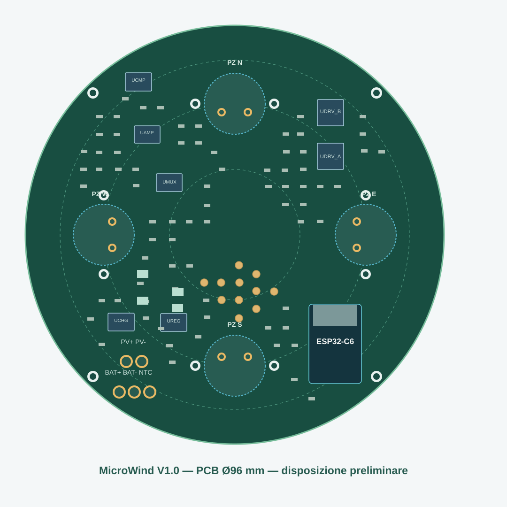

# MicroWind V1.0 — Anemometro ultrasonico

Repository del progetto **MicroWind V1.0**, revisione preliminare EasyEDA Pro.

## Anteprima PCB

La figura SVG è una **ricostruzione vettoriale dell'anteprima di disposizione preliminare**, non una fotografia della scheda né un'immagine esportata dal CAD. Per la geometria effettiva fare riferimento al file `.epro`. **Non è un progetto pronto per la fabbricazione.**

## File sorgente
- `MicroWind_V1_REVISED_V2.epro`: archivio nativo **EasyEDA Pro** fornito il 15 novembre 2026.
- SHA-256 del file .epro: `5c6a0a9d55ca022c4b179bce252425cc8226c62513541a037e24f74b22051c63`.
- Contiene **5 fogli di schema elettrico**, **1 layout PCB**, librerie interne di simboli e footprint.

## Predisposizione collegamenti a saldare

| Connettore | Pin | Rete |
|---|---|---|
| JPV (pannello solare) | 1 | PV_RAW |
| JPV | 2 | GND |
| JBAT (batteria) | 1 | BAT |
| JBAT | 2 | GND |
| JBAT | 3 | TS_BAT (NTC batteria) |
| JP_N / JP_E / JP_S / JP_W | 1 | PZ_N / PZ_E / PZ_S / PZ_W rispettivamente |
| JP_N / JP_E / JP_S / JP_W | 2 | GND |

Le reti sopra riportate sono state lette dai record PAD_NET del PCB nell'archivio .epro.

## Stato e limiti della revisione

**BOZZA — NON FABBRICARE.** I 5 fogli schema sono esplicitamente marcati come bozze. Il file PCB contiene 104 componenti, 73 reti e 305 associazioni piazzola/rete, ma **non contiene record di piste tracciate o via**.

Prima della produzione sono necessari la verifica dei footprint e dei pinout, la progettazione del routing e dei piani di massa, la verifica della zona RF dell'ESP32-C6, il controllo della parte analogica a 40 kHz e l'esecuzione di ERC/DRC nell'EDA. Non è documentata alcuna validazione elettrica o meccanica completa.

Il file è un *punto di partenza*, non Gerber pronti per l'ordine.
