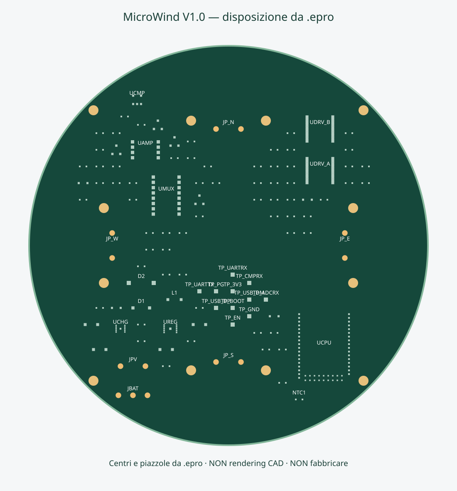

# MicroWind V1.0 — anemometro ultrasonico

**Progetto EasyEDA Pro, revisione PCB preliminare Ø96 mm. BOZZA — NON FABBRICARE.**

Il repository contiene il **sorgente CAD completo così come ricevuto**, le esportazioni documentali generate direttamente dal suo contenuto e una relazione con caratteristiche e punti ancora da validare. Non sono disponibili piste tracciate o Gerber di produzione.

## Anteprima ricostruita dai dati della PCB



> L'SVG sopra è una rappresentazione **automatica delle coordinate e piazzole** presenti nel file CAD, **non** un rendering ufficiale di EasyEDA e **non** una PCB instradata. Il sorgente da verificare nell'EDA è il file `.epro`.

## Sorgente e dettagli

- [Progetto nativo EasyEDA Pro `MicroWind_V1_REVISED_V2.epro`](MicroWind_V1_REVISED_V2.epro)
- [Dettagli tecnici verificati, blocchi funzionali, pin di batteria/pannello e criticità](docs/DETTAGLI_TECNICI.md)
- [Indice delle esportazioni e limiti](exports/LEGGIMI.md)

## Esportazioni verificabili

| File | Contenuto |
|---|---|
| [BOM_componenti.csv](exports/BOM_componenti.csv) | **104 componenti**: riferimento, valore, foglio, posizione e footprint |
| [netlist_pads.csv](exports/netlist_pads.csv) | **305 associazioni** tra pin/piazzole e reti |
| [netlist_reti.csv](exports/netlist_reti.csv) | **73 reti** con i relativi terminali |
| [pin_footprint.csv](exports/pin_footprint.csv) | Geometria locale di tutte le piazzole dei footprint |
| [connettori_saldatura.csv](exports/connettori_saldatura.csv) | Coordinate, pin e reti di **batteria, pannello e 4 sensori** |
| [fori_meccanici.csv](exports/fori_meccanici.csv) | Geometria dei **12 record MH** sul layer MULTI |
| [fogli_schema.csv](exports/fogli_schema.csv) | POWER, MCU, TEST, ACOUSTIC, PIEZO |
| [pcb_posizionamento_estratto.svg](exports/pcb_posizionamento_estratto.svg) | Vista vettoriale generata dai componenti e dai footprint presenti nel CAD |

## Collegamenti a saldare

| Connettore | Pin | Rete |
|---|---:|---|
| JPV (pannello solare) | 1 | PV_RAW (positivo) |
| JPV | 2 | GND (negativo) |
| JBAT (batteria) | 1 | BAT (+) |
| JBAT | 2 | GND (−) |
| JBAT | 3 | TS_BAT (NTC) |
| JP_N / JP_E / JP_S / JP_W | 1 | PZ_N / PZ_E / PZ_S / PZ_W |
| JP_N / JP_E / JP_S / JP_W | 2 | GND |

## Rigenera ogni dato dal file sorgente

```bash
python3 tools/export_easyeda.py MicroWind_V1_REVISED_V2.epro exports
```

Le esportazioni vengono rigenerate anche dalla [GitHub Action](.github/workflows/export-easyeda.yml) quando cambia il progetto o lo script. Non sono esportazioni scritte manualmente.

SHA-256 sorgente: `5c6a0a9d55ca022c4b179bce252425cc8226c62513541a037e24f74b22051c63`.

## Stato e blocchi da completare

- **Schema:** da validare elettricamente e tramite ERC.
- **PCB:** componenti posizionati; `TRACK=0`, `VIA=0`; routing e piani massa mancanti.
- **Footprint:** da verificare contro datasheet e libreria produttore, soprattutto ESP32-C6, ricarica, driver, RF e analogica a 40 kHz.
- **Meccanica:** confermare fori, altezza e inclinazione dei trasduttori, riflettore e antenna.
- **Alimentazione:** verificare compatibilità effettiva del circuito di carica con LiFePO₄ 1S, batteria protetta, pannello e sensore termico.
- **Fabbricazione:** non sono presenti Gerber o forature finali verificate. Eseguire DRC e revisioni prima di ordinare.

**Non considerare valori/posizioni estratti dal file come validati per la produzione.**
